# ⭐ Points Famille

🇫🇷 Français · [🇬🇧 English](README.md)

**Points Famille** remplace le tableau de points papier collé sur le frigo par une petite application web,
utilisable sur téléphone et tablette. Les enfants cochent leur routine du soir, les parents valident,
retirent des points quand les règles ne sont pas respectées, ajoutent des bonus pour les bonnes actions,
et les enfants échangent leurs points contre des récompenses. Tout est calculé automatiquement et l'historique est conservé.

L'application s'héberge chez soi (container LXC, VM, Raspberry Pi, NAS avec Docker…) : aucune donnée ne part
chez un service tiers.

## Sommaire

- [Fonctionnalités](#fonctionnalités)
- [Comment ça marche](#comment-ça-marche)
- [Captures d'écran](#captures-décran)
- [Installation](#installation)
  - [Option A : Debian / Ubuntu / container LXC](#option-a--debian--ubuntu--container-lxc-recommandé)
  - [Option B : Docker](#option-b--docker)
  - [Rendre l'application accessible en HTTPS](#rendre-lapplication-accessible-en-https)
  - [Essayer sur son ordinateur](#essayer-sur-son-ordinateur)
- [Première configuration](#première-configuration)
- [Installer sur le téléphone](#installer-sur-le-téléphone)
- [Mot de passe ou code PIN oublié](#mot-de-passe-ou-code-pin-oublié)
- [Sauvegardes et mises à jour](#sauvegardes-et-mises-à-jour)
- [Configuration avancée](#configuration-avancée)
- [Développement](#développement)

## Fonctionnalités

- 👨‍👩‍👧‍👦 **Toute la famille configurable** : nom de la famille, autant de parents que nécessaire (un compte chacun),
  jusqu'à 10 enfants (prénom, couleur, points de départ).
- 🌙 **Routine du soir** : liste d'habitudes qui rapportent des points, cochées chaque jour.
- ⚠️ **Petites règles** : points retirés (avec un maximum par jour si besoin, ex. « impoli : 3 fois max »).
- 🌟 **Bonus « bonne action »** : points libres avec un motif.
- 🎁 **Récompenses** : chaque récompense a un coût en points ; les enfants voient ce qu'ils peuvent s'offrir.
- ✅ **Validation parentale** : ce que cochent les enfants reste « en attente » jusqu'à validation d'un parent.
- 📋 **Vue semaine** identique à la fiche papier (gagnés / retirés / bonus / récompenses / total, points conservés).
- 📅 **Calendrier** mensuel par enfant, avec le total de chaque jour.
- ✏️ **Tout est modifiable** par les parents, directement depuis la journée ou dans les réglages ;
  modifier une règle ne change pas l'historique.
- 🌍 **6 langues** : français, anglais, espagnol, allemand, italien, portugais (choisie à l'installation).
- 📱 **Installable sur l'écran d'accueil** (PWA), thème clair / sombre automatique.
- 🔒 **Sécurisé** : mots de passe chiffrés (scrypt), protection CSRF, limitation des tentatives de connexion.

## Comment ça marche

| Qui | Peut faire |
|---|---|
| **Enfants** (un compte partagé + code PIN) | Choisir son prénom, cocher ses habitudes du jour (les jours passés sont en lecture seule pour eux), demander une récompense s'il a assez de points, voir son solde, la semaine et le calendrier. |
| **Parents** (un compte chacun) | Tout : valider ou refuser, cocher pour un enfant, retirer des points, donner des bonus, utiliser une récompense, corriger n'importe quel jour, gérer la famille, les règles et les comptes. |

- Une saisie d'enfant est **en attente** (jaune) jusqu'à validation ; une saisie de parent est validée d'office.
- **Solde** = points de départ + toutes les saisies validées. Il peut devenir négatif.
- Total du jour = total de la veille + gagnés − retirés + bonus − récompenses (comme sur la fiche papier).

## Captures d'écran

| Installation | Connexion | Choix de l'enfant | Journée (enfant) |
|---|---|---|---|
| 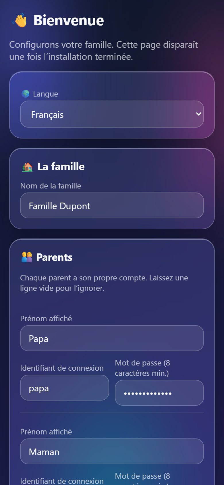 | 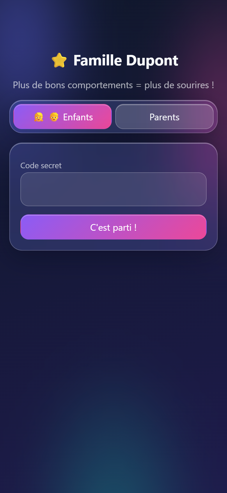 | 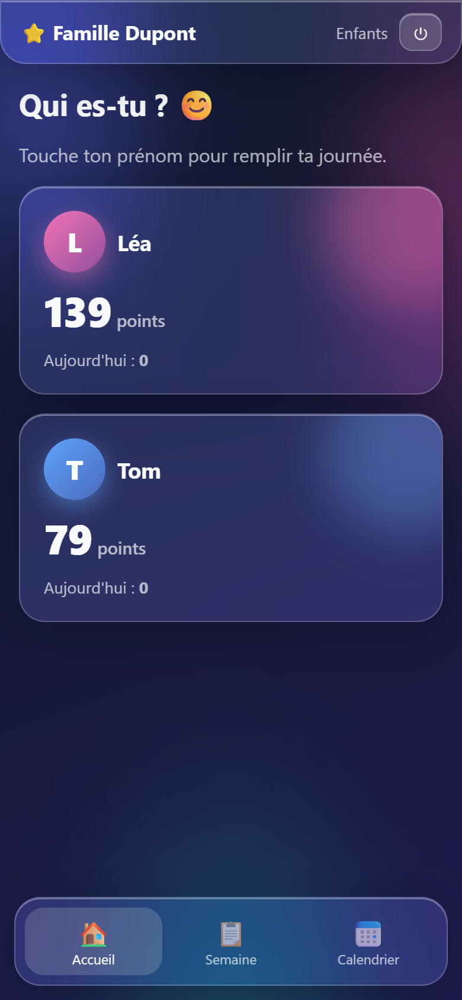 | 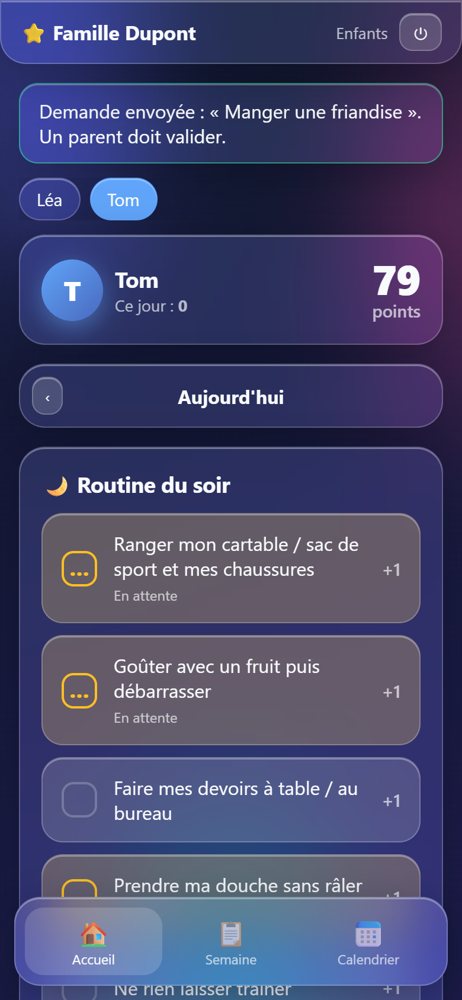 |

| Accueil (parent) | Journée (parent) | Modifier les règles | Validation |
|---|---|---|---|
| 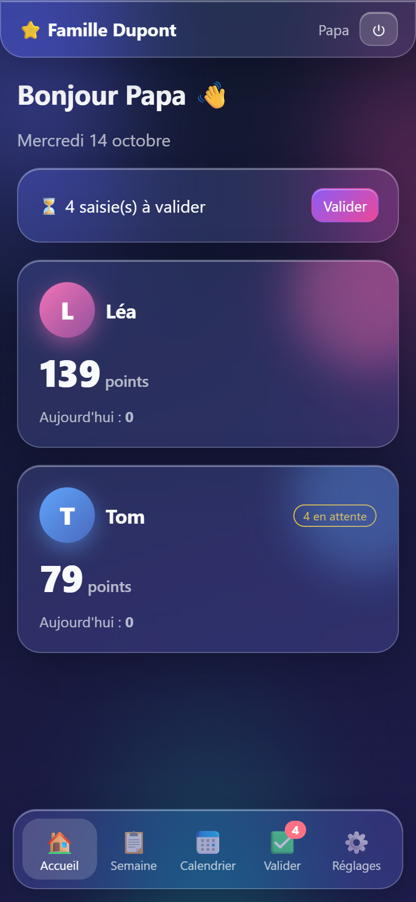 | 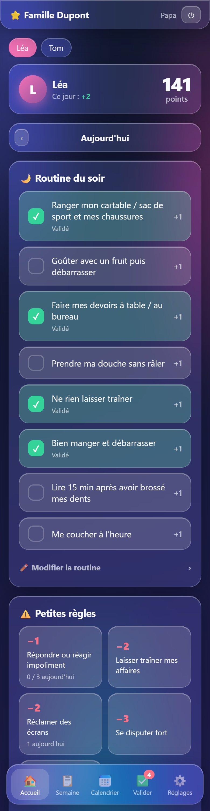 | 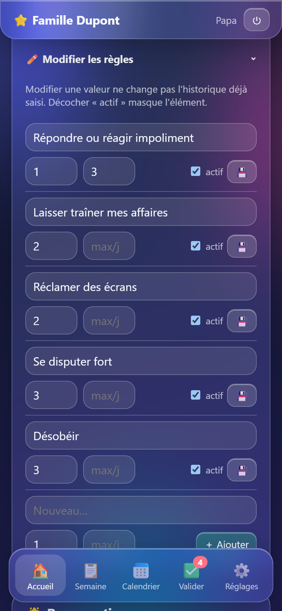 | 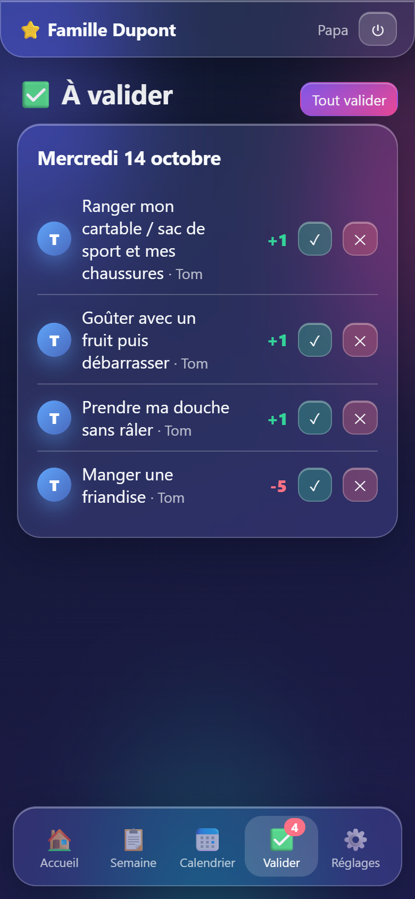 |

| Semaine | Calendrier | Réglages |
|---|---|---|
| 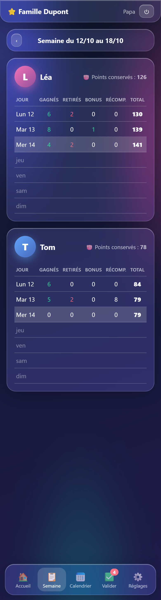 | 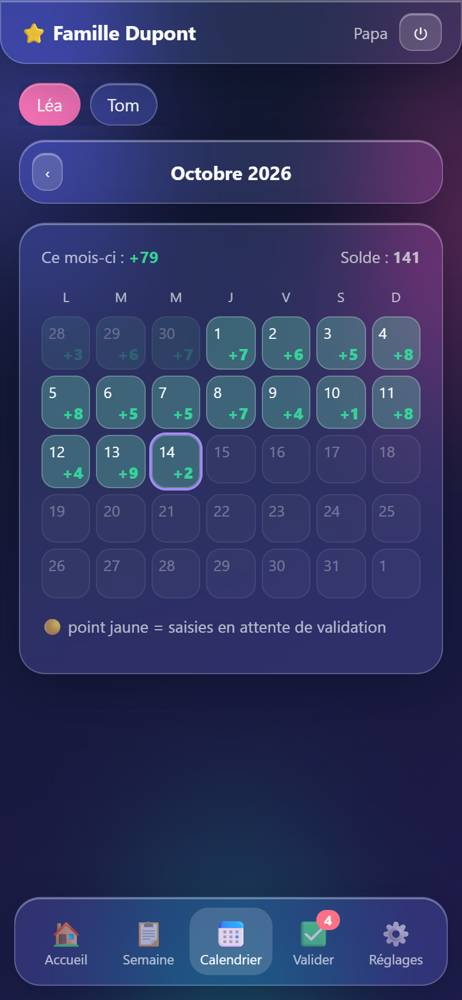 | 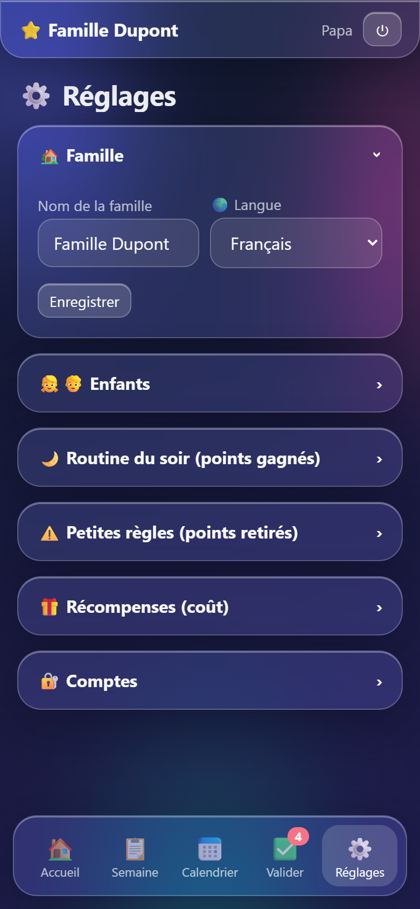 |

## Installation

Il faut une machine allumée en permanence : un container LXC (Proxmox), une VM, un Raspberry Pi, un NAS…
L'application est légère (Python, base SQLite dans un seul fichier, ~50 Mo de RAM).

### Option A : Debian / Ubuntu / container LXC (recommandé)

Sur un Debian 12+ ou Ubuntu 22.04+ fraîchement installé :

```bash
apt install -y git
git clone https://github.com/siom7/Childs-Rewards.git
cd Childs-Rewards
sudo bash deploy/install.sh
```

Le script :
- installe Python et les dépendances dans `/opt/childs-rewards` ;
- crée un utilisateur système dédié et un service `childs-rewards` (démarrage automatique) ;
- stocke les données dans `/var/lib/childs-rewards` ;
- programme une **sauvegarde quotidienne** dans `/var/backups/childs-rewards` (30 dernières copies).

L'application écoute sur `127.0.0.1:8000`. Si le reverse proxy est sur **une autre machine**
(ex. Nginx Proxy Manager dans un autre container) :

```bash
sudo CR_BIND=0.0.0.0 bash deploy/install.sh
```

puis, dans `/etc/systemd/system/childs-rewards.service`, remplacer `--forwarded-allow-ips 127.0.0.1`
par l'IP du reverse proxy et lancer `systemctl daemon-reload && systemctl restart childs-rewards`.

### Option B : Docker

```bash
git clone https://github.com/siom7/Childs-Rewards.git
cd Childs-Rewards
mkdir -p data && sudo chown 10001 data   # le container tourne avec l'utilisateur 10001
docker compose up -d --build
```

L'application écoute sur `127.0.0.1:8000`, les données sont dans `./data`.
Pour un essai sans HTTPS, mettre `CR_COOKIE_SECURE: "0"` dans `docker-compose.yml`.

### Rendre l'application accessible en HTTPS

Pour l'utiliser depuis l'extérieur, il faut un nom de domaine (ou un sous-domaine, ex. `points.mondomaine.fr`)
qui pointe vers votre box, la redirection des ports 80/443 vers le reverse proxy, et un certificat HTTPS.

**Avec NGINX** sur la même machine :

```bash
sudo apt install -y nginx certbot python3-certbot-nginx
sudo cp deploy/nginx.conf /etc/nginx/sites-available/childs-rewards
sudo nano /etc/nginx/sites-available/childs-rewards      # remplacer points.example.com
sudo ln -s /etc/nginx/sites-available/childs-rewards /etc/nginx/sites-enabled/
sudo certbot --nginx -d points.mondomaine.fr
sudo nginx -t && sudo systemctl reload nginx
```

**Avec Nginx Proxy Manager** : créer un « Proxy Host » vers `http://<ip-du-container>:8000`,
cocher « Block Common Exploits », puis dans l'onglet SSL demander un certificat Let's Encrypt et cocher « Force SSL ».

> 💡 Sans exposer l'application sur Internet, un VPN (Tailscale, WireGuard) fonctionne aussi très bien.
> Dans ce cas, sans HTTPS, mettre `CR_COOKIE_SECURE=0`.

### Essayer sur son ordinateur

Avec Python 3.11+ :

```bash
python -m venv .venv
.venv/bin/pip install -r requirements.txt          # Windows : .venv\Scripts\pip ...
.venv/bin/uvicorn app.main:app --port 8000          # Windows : .venv\Scripts\uvicorn ...
```

Puis ouvrir http://localhost:8000.

## Première configuration

À la première visite, l'application affiche la page d'installation :

1. **Langue** de l'application.
2. **Nom de la famille**.
3. **Parents** : prénom, identifiant et mot de passe (8 caractères minimum) pour chacun.
4. **Enfants** : prénom, couleur, points de départ (pour reprendre un solde existant).
5. **Code PIN des enfants** (4 à 8 chiffres) : un seul compte partagé, chaque enfant choisit ensuite son prénom.
6. **Règles de départ** : pré-remplir avec des exemples (modifiables) ou partir de listes vides.

Cette page disparaît ensuite. Tout reste modifiable dans **⚙️ Réglages**.

## Installer sur le téléphone

- **iPhone / iPad** (Safari) : bouton Partager → « Sur l'écran d'accueil ».
- **Android** (Chrome) : menu ⋮ → « Installer l'application » / « Ajouter à l'écran d'accueil ».

L'application s'ouvre alors en plein écran, comme une application classique.
Chaque appareil reste connecté 90 jours.

## Mot de passe ou code PIN oublié

L'application n'envoie pas d'e-mails : c'est voulu (rien à configurer, aucune donnée envoyée à l'extérieur).

- **Code PIN des enfants** ou **mot de passe d'un parent** : un autre parent le change dans
  ⚙️ Réglages → Comptes.
- **Le seul parent a oublié son mot de passe** : sur le serveur (l'accès au serveur fait office de preuve) :

```bash
cd /opt/childs-rewards
sudo -u childs-rewards CR_DATA_DIR=/var/lib/childs-rewards .venv/bin/python -m app.cli list-users
sudo -u childs-rewards CR_DATA_DIR=/var/lib/childs-rewards .venv/bin/python -m app.cli reset-password <identifiant>
sudo -u childs-rewards CR_DATA_DIR=/var/lib/childs-rewards .venv/bin/python -m app.cli reset-pin
```

Avec Docker : `docker compose exec app python -m app.cli reset-password <identifiant>`.

Après 10 tentatives de connexion ratées, une adresse IP est bloquée 15 minutes.

## Sauvegardes et mises à jour

- **Sauvegarde** : toutes les données tiennent dans un fichier (`childs_rewards.db`). L'installation
  Debian/LXC en fait une copie chaque nuit dans `/var/backups/childs-rewards`. Manuellement :
  `python -m app.cli backup <dossier>`. Pensez aussi à sauvegarder le container lui-même (ex. sauvegardes Proxmox).
- **Restauration** : arrêter le service, remettre le fichier dans `/var/lib/childs-rewards/childs_rewards.db`, redémarrer.
- **Mise à jour** :

```bash
cd Childs-Rewards && git pull && sudo bash deploy/install.sh      # Debian / LXC
git pull && docker compose up -d --build                          # Docker
```

## Configuration avancée

Variables d'environnement (dans le service systemd ou `docker-compose.yml`) :

| Variable | Défaut | Rôle |
|---|---|---|
| `CR_DATA_DIR` | `./data` | Dossier de la base SQLite et de la clé secrète |
| `CR_SECRET_KEY` | générée dans `data/secret_key` | Signature des cookies de session |
| `CR_COOKIE_SECURE` | `0` | `1` = cookie envoyé uniquement en HTTPS (à activer en production) |
| `CR_TIMEZONE` | `Europe/Paris` | Fuseau horaire utilisé pour « aujourd'hui » |

## Développement

```bash
pip install -r requirements-dev.txt
uvicorn app.main:app --reload            # serveur de développement
pytest -q                                # tests
python tools/i18n_extract.py             # vérifie que toutes les traductions sont présentes
python tools/screenshots.py fr en        # régénère les captures (nécessite: pip install playwright + Chrome)
```

- Python 3.11+, FastAPI, SQLAlchemy, SQLite, templates Jinja2, aucun build JavaScript.
- **Traductions** : le français est la langue source (`_("…")` dans le code et les templates) ;
  les autres langues sont dans `app/locales/<code>.json`. Pour ajouter une langue : créer le fichier JSON,
  l'ajouter à `LANGUAGES` dans `app/i18n.py`, puis lancer `tools/i18n_extract.py`.
