# ⭐ Family Points (Childs-Rewards)

[🇫🇷 Français](README.fr.md) · 🇬🇧 English

**Family Points** replaces the paper reward chart stuck on the fridge with a small web app that works on phones
and tablets. Children tick off their evening routine, parents approve, remove points when house rules are broken,
add bonuses for good deeds, and children trade their points for rewards. Everything is calculated automatically
and the history is kept.

It is self-hosted (LXC container, VM, Raspberry Pi, NAS with Docker…): no data is sent to any third party.

## Contents

- [Features](#features)
- [How it works](#how-it-works)
- [Screenshots](#screenshots)
- [Installation](#installation)
  - [Option A: Debian / Ubuntu / LXC container](#option-a-debian--ubuntu--lxc-container-recommended)
  - [Option B: Docker](#option-b-docker)
  - [Making it reachable over HTTPS](#making-it-reachable-over-https)
  - [Trying it on your computer](#trying-it-on-your-computer)
- [First setup](#first-setup)
- [Installing on a phone](#installing-on-a-phone)
- [Forgotten password or PIN](#forgotten-password-or-pin)
- [Backups and updates](#backups-and-updates)
- [Advanced configuration](#advanced-configuration)
- [Development](#development)

## Features

- 👨‍👩‍👧‍👦 **Your whole family, configurable**: family name, as many parents as needed (one account each),
  up to 10 children (name, colour, starting points).
- 🌙 **Evening routine**: a list of habits that earn points, ticked every day.
- ⚠️ **House rules**: points removed (with an optional daily limit, e.g. "rude: 3 times max").
- 🌟 **"Good deed" bonus**: free amount of points with a reason.
- 🎁 **Rewards**: each reward has a cost in points; children see what they can afford.
- ✅ **Parental approval**: whatever children tick stays "pending" until a parent approves it.
- 📋 **Weekly view** matching the paper chart (earned / removed / bonus / rewards / total, points carried over).
- 📅 **Monthly calendar** per child, with each day's total.
- 🗂️ **History kept for 1 year** by default (6 months, 2 years or unlimited): older days are deleted
  automatically without changing the balance (their points are archived).
- ✏️ **Everything is editable** by parents, right from the day page or in the settings;
  editing a rule does not change past entries.
- 🌍 **6 languages**: French, English, Spanish, German, Italian, Portuguese (chosen during setup).
- 📱 **Installable on the home screen** (PWA), automatic light / dark theme.
- 🔒 **Secure**: hashed passwords (scrypt), CSRF protection, login attempt limiting.

## How it works

| Who | Can do |
|---|---|
| **Children** (one shared account + PIN code) | Pick their name, tick their habits for today (past days are read-only for them), request a reward if they have enough points, see their balance, the week and the calendar. |
| **Parents** (one account each) | Everything: approve or reject, tick for a child, remove points, give bonuses, use a reward, fix any day, manage the family, rules and accounts. |

- A child's entry is **pending** (yellow) until approved; a parent's entry is approved straight away.
- **Balance** = starting points + all approved entries. It can go negative.
- Day total = previous day's total + earned − removed + bonus − rewards (just like the paper chart).

## Screenshots

| Setup | Sign in | Pick a child | Day (child) |
|---|---|---|---|
| 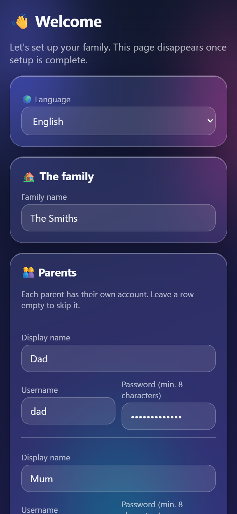 | 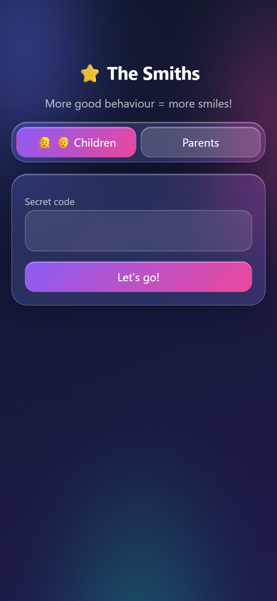 | 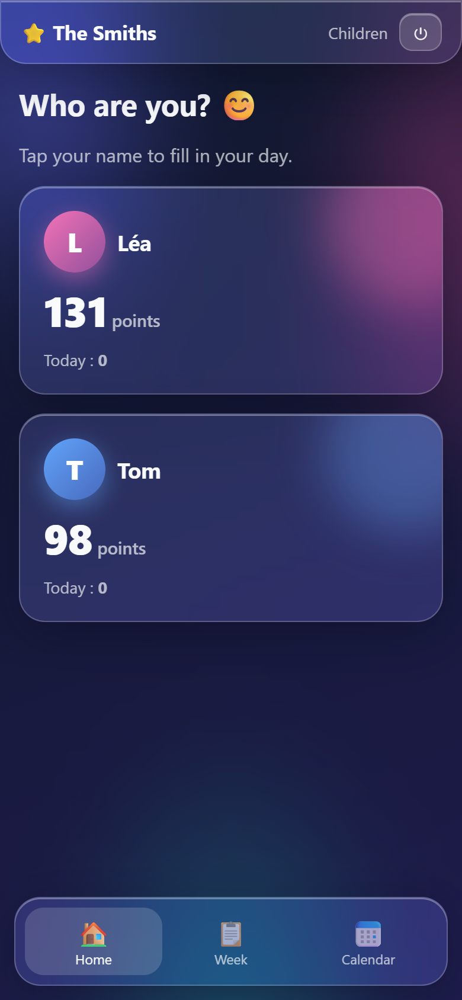 | 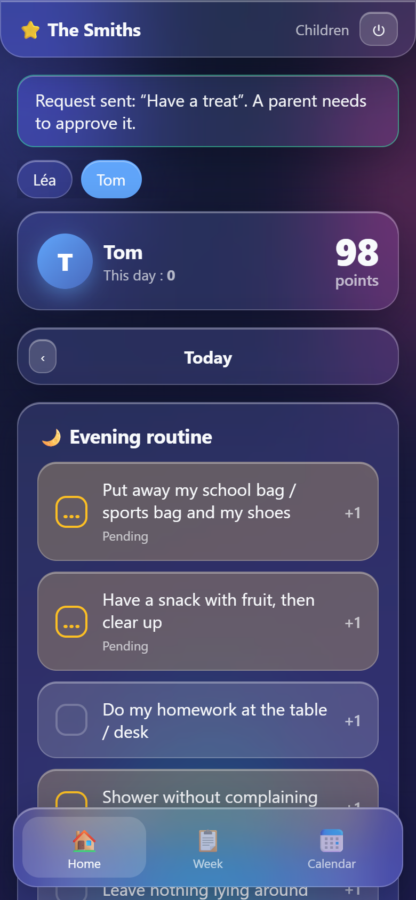 |

| Home (parent) | Day (parent) | Editing rules | Approval |
|---|---|---|---|
| 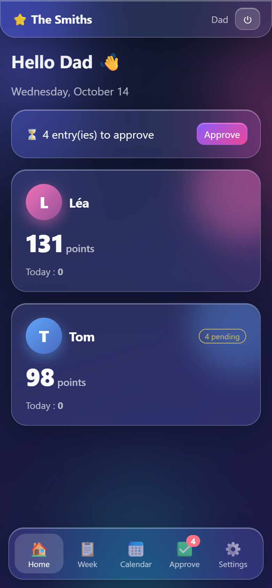 | 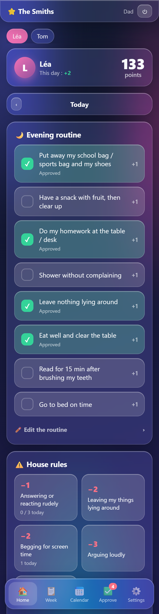 | 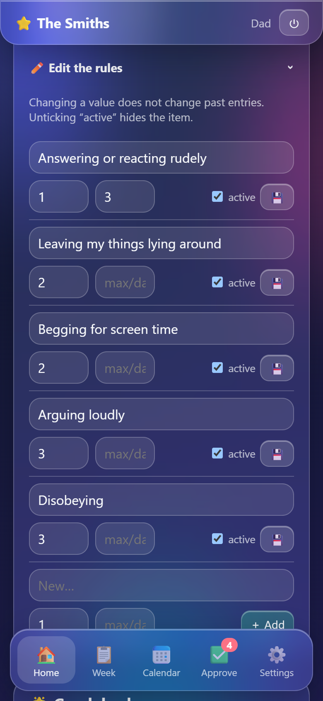 | 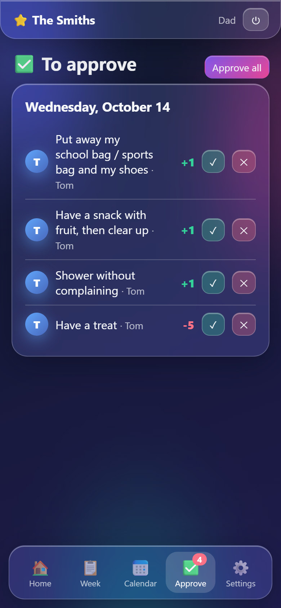 |

| Week | Calendar | Settings |
|---|---|---|
| 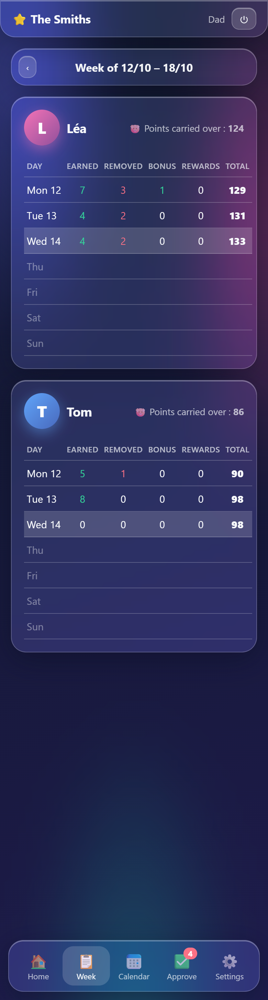 | 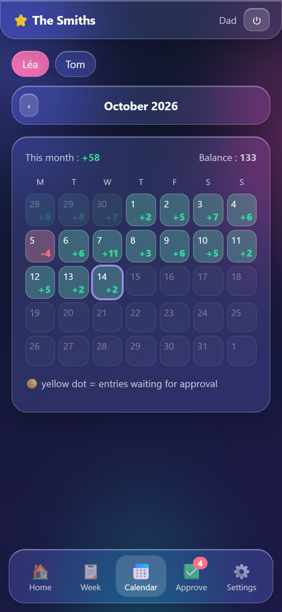 | 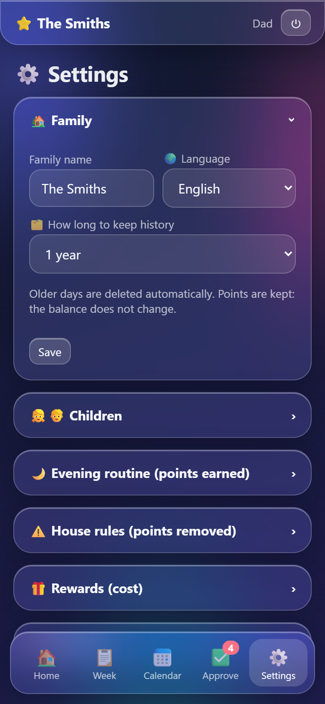 |

## Installation

You need a machine that is always on: an LXC container (Proxmox), a VM, a Raspberry Pi, a NAS…
The app is lightweight (Python, SQLite database in a single file, ~50 MB of RAM).

### Option A: Debian / Ubuntu / LXC container (recommended)

On a fresh Debian 12+ or Ubuntu 22.04+:

```bash
apt install -y git
git clone https://github.com/siom7/Childs-Rewards.git
cd Childs-Rewards
sudo bash deploy/install.sh
```

The script:
- installs Python and the dependencies in `/opt/childs-rewards`;
- creates a dedicated system user and a `childs-rewards` service (starts automatically);
- stores data in `/var/lib/childs-rewards`;
- schedules a **daily backup** to `/var/backups/childs-rewards` (last 30 copies kept).

The app listens on `127.0.0.1:8000`. If the reverse proxy runs on **another machine**
(e.g. Nginx Proxy Manager in another container):

```bash
sudo CR_BIND=0.0.0.0 CR_FORWARDED_ALLOW_IPS=<reverse-proxy-ip> bash deploy/install.sh
```

These settings are saved in `/etc/childs-rewards.env` and **kept across updates**: no need to repeat them.
You can also edit that file and run `sudo systemctl restart childs-rewards`.

### Option B: Docker

```bash
git clone https://github.com/siom7/Childs-Rewards.git
cd Childs-Rewards
mkdir -p data && sudo chown 10001 data   # the container runs as user 10001
docker compose up -d --build
```

The app listens on `127.0.0.1:8000`, data is stored in `./data`.
It works over plain `http://` for a first try; the session cookie automatically becomes `Secure` once you go through HTTPS.

### Making it reachable over HTTPS

To use it from outside your home you need a domain name (or a subdomain, e.g. `points.mydomain.com`)
pointing to your router, ports 80/443 forwarded to the reverse proxy, and an HTTPS certificate.

**With NGINX** on the same machine:

```bash
sudo apt install -y nginx certbot python3-certbot-nginx
sudo cp deploy/nginx.conf /etc/nginx/sites-available/childs-rewards
sudo nano /etc/nginx/sites-available/childs-rewards      # replace points.example.com
sudo ln -s /etc/nginx/sites-available/childs-rewards /etc/nginx/sites-enabled/
sudo certbot --nginx -d points.mydomain.com
sudo nginx -t && sudo systemctl reload nginx
```

**With Nginx Proxy Manager**: create a "Proxy Host" to `http://<container-ip>:8000`,
tick "Block Common Exploits", then in the SSL tab request a Let's Encrypt certificate and tick "Force SSL".

> 💡 If you'd rather not expose it to the Internet, a VPN (Tailscale, WireGuard) works great too.

### Trying it on your computer

With Python 3.11+:

```bash
python -m venv .venv
.venv/bin/pip install -r requirements.txt          # Windows: .venv\Scripts\pip ...
.venv/bin/uvicorn app.main:app --port 8000          # Windows: .venv\Scripts\uvicorn ...
```

Then open http://localhost:8000.

## First setup

On the first visit, the app shows the setup page:

1. **Language** of the app.
2. **Family name**.
3. **Parents**: display name, username and password (at least 8 characters) for each one.
4. **Children**: name, colour, starting points (to carry over an existing balance).
5. **Children's PIN code** (4 to 8 digits): one shared account, each child then picks their name.
6. **Starting rules**: pre-fill with (editable) examples or start with empty lists.

This page then disappears. Everything can be changed later in **⚙️ Settings**.

## Installing on a phone

- **iPhone / iPad** (Safari): Share button → "Add to Home Screen".
- **Android** (Chrome): ⋮ menu → "Install app" / "Add to Home screen".

The app then opens full screen, like a regular app. Each device stays signed in for 90 days.

## Forgotten password or PIN

The app does not send e-mails, on purpose (nothing to configure, no data sent outside).

- **Children's PIN** or **a parent's password**: another parent changes it in ⚙️ Settings → Accounts.
- **The only parent forgot their password**: on the server (server access serves as proof):

```bash
cd /opt/childs-rewards
sudo -u childs-rewards CR_DATA_DIR=/var/lib/childs-rewards .venv/bin/python -m app.cli list-users
sudo -u childs-rewards CR_DATA_DIR=/var/lib/childs-rewards .venv/bin/python -m app.cli reset-password <username>
sudo -u childs-rewards CR_DATA_DIR=/var/lib/childs-rewards .venv/bin/python -m app.cli reset-pin
```

With Docker: `docker compose exec app python -m app.cli reset-password <username>`.

After 10 failed sign-in attempts, an IP address is blocked for 15 minutes.

## Backups and updates

- **Backup**: all data lives in one file (`childs_rewards.db`). The Debian/LXC install copies it every night
  to `/var/backups/childs-rewards`. Manually: `python -m app.cli backup <folder>`.
  Also back up the container itself (e.g. Proxmox backups).
- **History retention**: set in ⚙️ Settings → Family (1 year by default). Cleanup runs automatically once a day;
  manually: `python -m app.cli purge`.
- **Restore**: stop the service, put the file back as `/var/lib/childs-rewards/childs_rewards.db`, restart.
- **Update**:

```bash
cd Childs-Rewards && git pull && sudo bash deploy/install.sh      # Debian / LXC
git pull && docker compose up -d --build                          # Docker
```

## Advanced configuration

Environment variables (in `/etc/childs-rewards.env` for the Debian/LXC install, or in `docker-compose.yml`):

| Variable | Default | Purpose |
|---|---|---|
| `CR_DATA_DIR` | `./data` | Folder for the SQLite database and the secret key |
| `CR_SECRET_KEY` | generated in `data/secret_key` | Signs session cookies |
| `CR_BIND` / `CR_PORT` | `127.0.0.1` / `8000` | Listening address and port (Debian/LXC install) |
| `CR_FORWARDED_ALLOW_IPS` | `127.0.0.1` | Reverse proxy IP allowed to pass on the visitor's IP and protocol |
| `CR_COOKIE_SECURE` | `auto` | `auto` = `Secure` cookie when the page is served over HTTPS (directly or via the reverse proxy); `1` = always (site only works over HTTPS); `0` = never |
| `CR_TIMEZONE` | `Europe/Paris` | Time zone used for "today" |

## Development

```bash
pip install -r requirements-dev.txt
uvicorn app.main:app --reload            # development server
pytest -q                                # tests
python tools/i18n_extract.py             # checks that every translation is present
python tools/screenshots.py fr en        # regenerates screenshots (needs: pip install playwright + Chrome)
```

- Python 3.11+, FastAPI, SQLAlchemy, SQLite, Jinja2 templates, no JavaScript build.
- **Translations**: French is the source language (`_("…")` in code and templates);
  other languages live in `app/locales/<code>.json`. To add a language: create the JSON file,
  add it to `LANGUAGES` in `app/i18n.py`, then run `tools/i18n_extract.py`.
